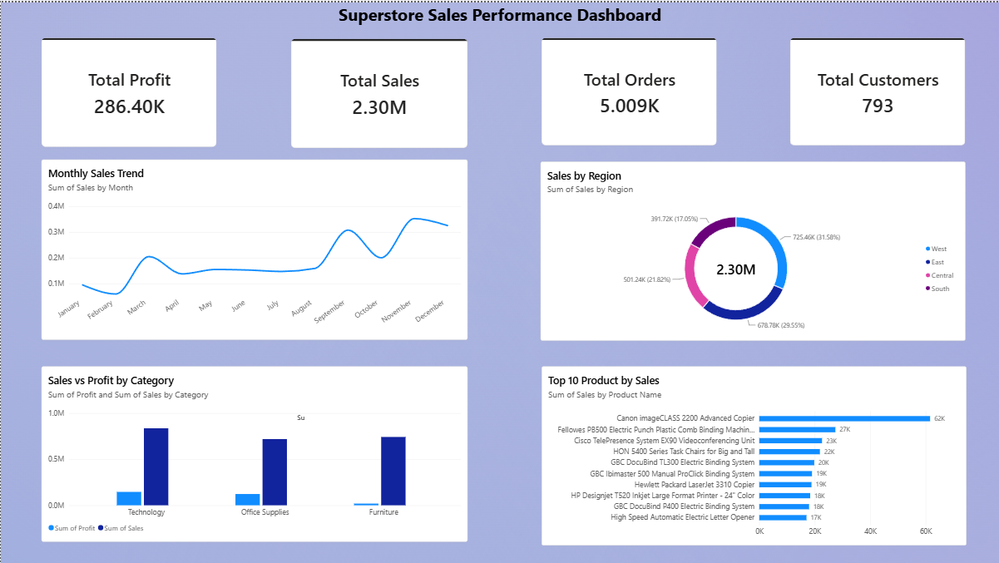

# Business Sales Performance Analytics

## Future Interns – Data Science & Analytics Internship
### Task 1

This project focuses on analyzing Superstore sales data to understand business performance and create an interactive sales dashboard.

## Project Objective

The main objectives of this project are:

- Analyze overall sales and profit performance.
- Identify high-performing categories and products.
- Compare sales performance across different regions.
- Analyze monthly sales trends.
- Understand the relationship between discounts and profit.
- Create an interactive dashboard for business decision-making.

## Dataset

The project uses the Superstore Sales dataset.

The dataset contains:

- 9,994 rows
- 21 columns

Important fields include:

- Order Date
- Ship Date
- Customer ID
- Product Name
- Category
- Region
- Sales
- Quantity
- Discount
- Profit

## Tools & Technologies

- Python
- Pandas
- Jupyter Notebook
- Power BI
- Microsoft Excel

## Data Cleaning

The following data preparation steps were performed:

- Checked for duplicate records.
- Checked for missing values.
- Converted date columns into proper date format.
- Prepared the dataset for analysis and visualization.

The dataset contained 0 duplicate records.

## Data Analysis

The analysis covers:

- Sales and profit by category
- Sales and profit by region
- Top 10 products by sales
- Monthly sales trends
- Discount and profit analysis
- Overall sales, profit, orders, and customers

## Business Insights

- Sales and profit vary across different product categories.
- Regional performance differs across the business.
- Some products contribute significantly to overall sales.
- Monthly sales trends show periods of higher and lower sales.
- Discount levels can affect profitability.
- High sales do not always result in high profit.

## Business Recommendations

1. Focus on categories that generate strong sales and profit.
2. Develop region-specific strategies for lower-performing regions.
3. Maintain sufficient inventory for top-performing products.
4. Optimize discount policies to protect profit margins.
5. Use monthly sales trends to plan inventory and marketing campaigns.
6. Monitor both sales and profit when making business decisions.

## Power BI Dashboard



The Power BI dashboard provides a visual overview of business performance using:

- Total Sales
- Total Profit
- Total Orders
- Total Customers
- Monthly Sales Trend
- Sales vs Profit by Category
- Sales by Region
- Top 10 Products by Sales

## Project Structure

```text
Future_Interns_Task_1
│
├── notebook
│   └── sales_analysis.ipynb
│
├── report
│   └── Task_1_Report.pdf
│
├── charts
│
├── Superstore_Sales_Dashboard.pbix
│
└── README.md